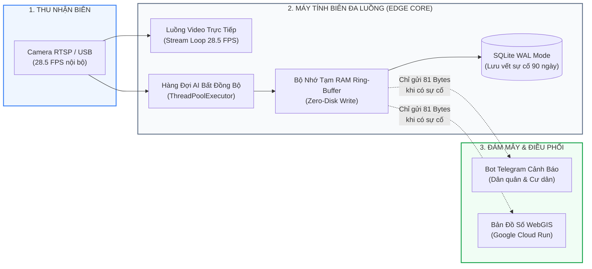

# 📑 KỊCH BẢN NỘI DUNG TẠO SLIDE THUYẾT TRÌNH (DÀNH CHO NOTEBOOKLM)
## DỰ ÁN: URBANSHIELD LITE – GIÁM SÁT NGẬP NƯỚC & SỰ CỐ NGÕ HẺM BẰNG EDGE AI TRÊN CPU
### ĐỘI THI: SINGLENODE | CUỘC THI: SGU HACKATHON 2026

> **Hướng dẫn nạp vào NotebookLM:**  
> Sao chép toàn bộ nội dung file này hoặc tải file `docs/KICH_BAN_SLIDE_NOTEBOOKLM.md` lên NotebookLM làm nguồn tài liệu (Source Document). Toàn bộ nội dung kịch bản đã được tinh chỉnh chuyên sâu vào **Kiến trúc hệ thống (System Architecture)**, **Bảng công nghệ sử dụng (Technology Stack)** và **Luồng dữ liệu/thuật toán (Data & Algorithmic Pipelines)** theo đúng tiêu chí chấm điểm kỹ thuật của Ban Giám khảo.

---

## 🖥️ SLIDE 1: TRANG BÌA & TỔNG QUAN HỆ THỐNG
* **Tiêu đề lớn:** UrbanShield Lite
* **Tiêu đề phụ:** Hệ thống Giám sát Ngập nước & Sự cố Ngõ hẻm bằng Edge AI trên CPU phổ thông
* **Đội thi:** SingleNode – Trường Đại học Sài Gòn (SGU)
* **Liên kết Live Demo Cloud Run:** `https://urbanshield-sgu-128758538305.asia-southeast1.run.app/`
* **Thông điệp cốt lõi:** Kiến trúc suy luận tại biên (Edge Computing), tối ưu gói tin cảnh báo 81 Bytes & Triển khai một container trên Google Cloud Run với chi phí 0 đồng.
* **Bố cục thị giác (Nền trắng tối giản):**
  * Logo chiếc khiên bảo vệ khu phố màu xanh navy `#0F172A`.
  * Ảnh chụp thực tế giao diện WebGIS đang chạy trực tiếp: Camera AI nhận diện mốc bánh xe 50cm, vạch ngấn nước màu đỏ và bản đồ số đổi màu thời gian thực.
* **Lời thoại người nói (Speaker Notes - Trao đổi 1-1 trực diện với Ban Giám khảo):**
  > "Ở TP.HCM, mỗi mùa mưa hay triều cường, những con đường nhỏ và ngõ hẻm luôn là nơi ngập sâu nhất, người dân dắt xe chết máy và ngã xe nhiều nhất. Nhưng hiện tại các hệ thống cảnh báo hầu như chỉ phủ được ở trục đường lớn, còn ngõ hẻm bị bỏ quên vì thiết bị quá đắt và không thể kéo video liên tục về trung tâm. UrbanShield Lite ra đời để giải quyết đúng bài toán đó: biến camera có sẵn và máy tính cũ ở khu phố thành trạm quan trắc ngập và cứu hộ tai nạn tại chỗ."

---

## 🌧️ SLIDE 2: BÀI TOÁN THỰC TẾ & THÁCH THỨC KỸ THUẬT TẠI HẠ TẦNG NGÕ HẺM
* **Tiêu đề:** Thực trạng ngõ hẻm mùa mưa & 3 bài toán kỹ thuật cần giải quyết
* **Nỗi đau dân sinh thực tế:**
  1. **Ngập nước gây chết máy:** Triều cường và mưa lớn làm đường nhỏ và hẻm trũng ngập sâu 20–40cm, bà con đi làm về không biết trước, hàng loạt xe máy bị chết máy phải dắt bộ trong đêm mưa.
  2. **Tai nạn ngã xe khó được phát hiện kịp thời:** Mặt đường dốc trơn trượt hoặc nước ngập che mất ổ gà khiến người dân dễ bị ngã xe trong hẻm vắng.
* **3 Rào cản kỹ thuật tại hạ tầng địa phương:**
  * **Rào cản 1 - Đường truyền mạng:** Kéo video liên tục về máy chủ đám mây làm nghẽn toàn bộ đường truyền mạng ngõ hẻm (ngốn khoảng 450 MB/giờ/camera).
  * **Rào cản 2 - Chi phí phần cứng:** Mua camera chuyên dụng đo ngập hoặc lắp máy trạm gắn card đồ họa GPU rời thì quá đắt đỏ, ngân sách tổ dân phố không kham nổi.
  * **Rào cản 3 - Quyền riêng tư:** Người dân lo ngại hình ảnh sinh hoạt riêng tư trong ngõ hẻm bị lưu trữ tùy tiện lên máy chủ bên ngoài.
* **Bố cục thị giác:**
  * Chia 3 cột thẻ trắng viền xám mảnh: Cột 1 (Nghẽn mạng 450 MB/h) – Cột 2 (Phần cứng GPU đắt đỏ) – Cột 3 (Nguy cơ lộ video riêng tư).
* **Lời thoại người nói (Speaker Notes - Trao đổi 1-1 trực diện):**
  > "Cái khó lớn nhất khi đưa công nghệ về ngõ hẻm là hạ tầng: mua camera chuyên dụng thì ngân sách địa phương không kham nổi, còn dùng camera thường kéo video về máy chủ thì mưa bão chắc chắn nghẽn mạng. Chưa kể bà con rất e ngại việc camera công cộng theo dõi và lưu video sinh hoạt đời tư. Vì vậy, bài toán nhóm em tự đặt ra là: toàn bộ AI phải chạy trực tiếp trên CPU của máy tính văn phòng cũ, video chỉ đọc trên RAM rồi tự hủy ngay, và khi có sự cố thì chỉ gửi đi một mẩu tin văn bản nhỏ đúng 81 Bytes."

---

## 🏛️ SLIDE 3: KIẾN TRÚC TỔNG THỂ HỆ THỐNG (SYSTEM ARCHITECTURE BLUEPRINT)
* **Tiêu đề slide:** KIẾN TRÚC 3 TẦNG PHÂN TÁCH BẤT ĐỒNG BỘ (DECOUPLED EDGE-CLOUD)
* **Nội dung hiển thị trên slide (100% Sơ đồ hình khối trực quan - Tuyệt đối không để chữ giải thích):**



* **Lời thoại người nói (Speaker Notes - Trao đổi 1-1 trực tiếp theo sơ đồ):**
  > "Nhìn vào sơ đồ kiến trúc, hệ thống chạy 3 tầng rất gọn: camera ngõ hẻm đẩy video nội bộ về máy tính khu phố. Tại đây, luồng hiển thị 28.5 khung hình một giây cho cán bộ trực ban được tách riêng hoàn toàn với hàng đợi AI chạy ngầm, nên máy tính không bao giờ bị giật lag hay đứng hình. Khung hình xử lý xong trên RAM là xóa ngay lập tức, bảo vệ tuyệt đối đời tư người dân. Và chỉ khi có ngập hay tai nạn, máy tính mới gửi một gói tin 81 Bytes lên Cloud và Telegram để điều động dân quân ra hiện trường."

---

## 🛠️ SLIDE 4: CÔNG NGHỆ SỬ DỤNG (TECHNOLOGY STACK)
* **Tiêu đề slide:** HỆ SINH THÁI CÔNG NGHỆ TINH GỌN (TECHNOLOGY STACK)
* **Nội dung hiển thị trên slide (100% Thẻ công nghệ / Tech Badges trực quan - Tuyệt đối không để chữ giải thích):**

```text
┌─────────────────────────────────────────┐  ┌─────────────────────────────────────────┐
│ 🧠 EDGE AI & COMPUTER VISION            │  │ ⚙️ BACKEND & DATABASE                   │
│ • Ultralytics YOLOv8-nano (3.2M params) │  │ • Python 3.10 & FastAPI (Clean Arch)    │
│ • OpenCV Headless (Sobel & CLAHE)       │  │ • SQLite (WAL Mode, Data Retention 90d) │
└─────────────────────────────────────────┘  └─────────────────────────────────────────┘
┌─────────────────────────────────────────┐  ┌─────────────────────────────────────────┐
│ 🗺️ FRONTEND & WEBGIS                    │  │ ☁️ CLOUD, CI/CD & TESTING               │
│ • React 18 & Vite & TailwindCSS         │  │ • Google Cloud Run (Serverless 0-cost)  │
│ • Leaflet WebGIS (GeoJSON LineString)   │  │ • Docker, Playwright E2E, Pytest (24/24)│
└─────────────────────────────────────────┘  └─────────────────────────────────────────┘
```

* **Lời thoại người nói (Speaker Notes - Trao đổi 1-1 trực tiếp lý do lựa chọn):**
  > "Về công nghệ, nhóm tối ưu cho phần cứng phổ thông: mô hình YOLOv8-nano nhỏ nhất 3.2 triệu tham số chạy trực tiếp trên CPU chỉ tốn 32 mili-giây, kết hợp OpenCV để tìm mép nước và bù sáng ban đêm. Phía backend dùng FastAPI và SQLite chế độ WAL để ghi nhật ký nhanh mà không cần cài đặt cồng kềnh. Giao diện dùng React và bản đồ số Leaflet theo định dạng chuẩn quốc tế GeoJSON. Toàn bộ đóng gói trong một container Docker duy nhất triển khai trên Google Cloud Run với chi phí 0 đồng, đi kèm 24 bài test tự động bảo đảm chạy đúng chuẩn."

---

## 🌊 SLIDE 5: LUỒNG THUẬT TOÁN 1 – ĐO NGẬP HÌNH HỌC QUA BÁNH XE MÁY 50CM
* **Tiêu đề:** Pipeline đo mực nước ngập: Tận dụng vật chuẩn di động dân sinh
* **Sơ đồ 4 bước xử lý tuần tự (Algorithmic Pipeline):**
  1. **Bước 1 - Phân loại bề mặt (Surface Classification):**
     * Trích xuất vùng nửa dưới khung hình, tính phương sai toán tử Laplacian ($\nabla^2$).
     * Mặt đường nhựa khô ráo có vân nhám cao (`lap_var > 3800.0`) $\rightarrow$ Xác nhận Khô ráo (0 cm).
     * Mặt nước ngập có tính chất phản xạ và gợn sóng (`lap_var <= 3000.0`) $\rightarrow$ Kích hoạt đo đạc.
  2. **Bước 2 - Lọc vật thể chuẩn trong hành lang giao thông:**
     * Nhận diện xe máy đang lưu thông trong lòng đường (`aspect_ratio <= 1.85`).
     * Kiểm tra độ che khuất ngang (`overlap > 40%`) để loại xe đi phía sau, chỉ lấy xe rõ nhất ở tiền cảnh.
  3. **Bước 3 - Trích xuất chân bánh xe & Đạo hàm Sobel:**
     * Cắt vùng chân bánh xe (35% chiều cao phía dưới).
     * Áp dụng bộ lọc đạo hàm Sobel theo trục dọc $G_y = \frac{\partial I}{\partial y}$ quét từ trên xuống dưới để tìm đỉnh biến thiên cường độ sáng lớn nhất — chính là vị trí mép nước cắt qua lốp xe.
  4. **Bước 4 - Quy đổi hình học & Bộ làm mịn EMA:**
     * Áp dụng công thức hình học mốc 50cm:
       $$\text{Độ ngập (cm)} = 50\text{ cm} \times \left(1 - \frac{\text{Chiều cao lốp còn nổi}}{\text{Toàn bộ chiều cao lốp}}\right)$$
     * Làm mịn biến động bằng hàm làm mịn mũ EMA ($0.7 \text{ EMA cũ} + 0.3 \text{ đo mới}$).
     * Duy trì bộ đệm giữ mẫu (Sample & Hold) 6.0 giây để chống chớp nháy khi xe vừa chạy qua.
* **Lời thoại người nói (Speaker Notes - Trao đổi 1-1 trực tiếp):**
  > "Về đo ngập, thay vì cắm cọc đo dễ bị rác cuốn trôi, hệ thống lấy chính bánh xe máy đang chạy qua đường làm thước đo chuẩn 50cm. Khi phát hiện mặt đường có gợn sóng, máy tính nhận diện chân bánh xe của xe máy đi gần nhất, dùng đạo hàm Sobel quét tìm ngấn nước cắt ngang lốp rồi quy đổi tỷ lệ hình học ra số centimet ngập thực tế. Kèm theo bộ lọc làm mịn để số đo không bị nhảy giật khi xe vừa chạy qua."

---

## 🛵 SLIDE 6: LUỒNG THUẬT TOÁN 2 – PHÁT HIỆN NGÃ XE & BỘ ĐẾM BẤT ĐỘNG 5 GIÂY
* **Tiêu đề:** Pipeline phát hiện ngã xe & Máy trạng thái chống báo động giả
* **Sơ đồ 4 bước xử lý tuần tự (Algorithmic Pipeline):**
  1. **Bước 1 - Lọc ứng viên ngã (Fall Candidates):**
     * Phát hiện người nằm ngang trên mặt đường với tỷ lệ khung bao $W/H > 1.15$ hoặc xe máy đổ nghiêng nằm gần người (khoảng cách tâm $< 180\text{ px}$).
  2. **Bước 2 - Bộ lọc loại trừ người lái xe bình thường (Seated-Rider Filter):**
     * Kiểm tra tương quan không gian: Nếu phần đầu người nhô cao trên yên xe máy đang chạy bình thường $\rightarrow$ Loại bỏ ngay, không đưa vào danh sách theo dõi.
  3. **Bước 3 - Máy trạng thái đếm thời gian (State Machine Tracker):**
     * Khởi tạo bộ đếm thời gian bất động `motionless_duration_sec`.
     * Theo dõi vị trí tâm $(\Delta x, \Delta y < 25\text{ px})$ qua từng khung hình liên tiếp.
  4. **Bước 4 - Tự hủy báo nhầm & Kích hoạt khẩn cấp:**
     * *Tự hủy báo giả:* Nếu người dân chỉ cúi xuống nhặt đồ hoặc dừng xe chống chân $< 5.0\text{ giây}$ rồi đứng dậy $\rightarrow$ Bộ đếm tự động hủy bỏ.
     * *Kích hoạt khẩn cấp:* Chỉ khi nạn nhân hoặc phương tiện nằm bất động liên tục $\ge 5.0\text{ giây}$ $\rightarrow$ Lập tức phát còi cảnh báo trực quan và gửi tin cứu hộ.
* **Lời thoại người nói (Speaker Notes - Trao đổi 1-1 trực tiếp):**
  > "Về tai nạn, bài toán đau đầu nhất là báo nhầm khi người dân cúi nhặt đồ hoặc dừng xe chống chân. Hệ thống giải quyết bằng máy trạng thái 5 giây: khi thấy dáng người đổ ngang, máy tính chỉ âm thầm bấm giờ. Nếu người đó tự đứng dậy trước 5 giây, cờ sự cố tự động hủy; chỉ khi người nằm bất động liên tục quá 5 giây thì còi báo động và tin nhắn khẩn cấp mới lập tức gửi về đội dân quân."

---

## 📡 SLIDE 7: LUỒNG TRUYỀN THÔNG DỮ LIỆU, GÓI TIN 81 BYTES & QUYỀN RIÊNG TƯ ZERO-DISK
* **Tiêu đề:** Kiến trúc tối ưu băng thông mạng & Cam kết an toàn dữ liệu
* **Bố cục 2 cột so sánh trực quan:**
  * **Cột 1 - Tối ưu băng thông mạng (Tiết kiệm 99.98%):**
    * *Cách cũ:* Kéo video 1080p liên tục về đám mây $\rightarrow$ Tốn **450 MB mỗi giờ** cho mỗi camera, nghẽn mạng ngõ hẻm.
    * *UrbanShield Lite:* Khi bình thường không tốn một byte mạng nào. Khi có sự cố ngập hoặc tai nạn, chỉ gửi **đúng 81 Bytes** định dạng JSON nén:
      ```json
      {"node_id":"node-sgu-01","type":"FLOOD","val":30.9,"unit":"cm","time":1794102792}
      ```
  * **Cột 2 - Cam kết bảo vệ quyền riêng tư (Privacy-by-Design):**
    * Khung hình video từ camera chỉ giải mã tạm thời vào mảng NumPy trên bộ nhớ RAM.
    * Ngay sau khi suy luận AI xong, hàm tự động gọi `del frame` và kích hoạt bộ thu gom rác bộ nhớ.
    * **Cam kết Zero-Disk write: 0 byte hình ảnh/video người dân bị ghi xuống ổ đĩa cứng.**
* **Lời thoại người nói (Speaker Notes - Trao đổi 1-1 trực tiếp):**
  > "Về đường truyền và bảo mật, thay vì ngốn 450 Megabyte mỗi giờ để kéo video làm nghẽn mạng ngõ hẻm, cả hệ thống chỉ truyền đúng một gói tin JSON 81 Bytes khi có sự cố. Toàn bộ hình ảnh chỉ nằm tạm trên mảng nhớ RAM của máy tính biên rồi tự giải phóng, cam kết 0 byte hình ảnh người dân bị ghi xuống ổ cứng."

---

## 🏆 SLIDE 8: THỰC CHỨNG KIỂM THỬ TỰ ĐỘNG, DEPLOY CLOUD & KẾT LUẬN
* **Tiêu đề:** Minh bạch thực nghiệm (Zero Fake Data) & Sẵn sàng ứng dụng thực tế
* **Các bằng chứng khoa học minh bạch:**
  * **Bộ kiểm thử tự động 100%:** Toàn bộ **`24 / 24 bài test (Pytest & Playwright E2E)`** đều đạt PASSED, có ảnh chụp màn hình terminal thực tế lưu trong hồ sơ nghiệm thu.
  * **Thực nghiệm trên video ngập thực tế TP.HCM:** Độ trễ suy luận CPU chỉ **103.9 ms**, nhận diện ngập sâu **30 - 43 cm**, không báo động giả khi đường khô ráo (**0.0 cm**).
  * **Triển khai Cloud đạt chuẩn tiêu chí VII:** Đã đóng gói và chạy thực tế trên **Google Cloud Run** tại địa chỉ: `https://urbanshield-sgu-128758538305.asia-southeast1.run.app/` (Singapore `asia-southeast1`, tự cấp chứng chỉ bảo mật HTTPS, chi phí 0 đồng).
* **Lời kết thuyết trình (Trao đổi 1-1 trực tiếp):**
  > "Toàn bộ giải pháp này đã vượt qua 100% bộ 24 bài kiểm thử tự động, chạy thực nghiệm chuẩn xác trên các video ngập lụt thực tế ở TP.HCM với độ trễ CPU chỉ 103 mili-giây, và hiện đang chạy thực tế trên Google Cloud Run tại Singapore với chi phí 0 đồng. Mục tiêu lớn nhất của nhóm em là tạo ra một giải pháp thiết thực, tiết kiệm và tôn trọng quyền riêng tư để giúp bà con lao động an tâm đi về trong những đêm mưa gió."
